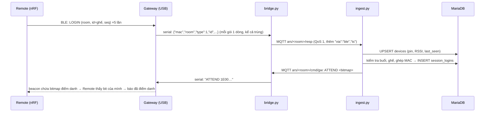

# ARS server — Hệ thống phản hồi lớp học bằng Remote

Phần mềm chạy trên **laptop giáo viên** (server). Học sinh bấm **Remote nRF52840** (Bluetooth) hoặc **ESP32** (Wi-Fi); server nhận đáp án, kiểm tra hợp lệ, lưu vào MariaDB và hiển thị trên web giáo viên, màn chiếu, cổng học sinh và phụ huynh.

> Nguyên tắc thiết kế: **Remote và gateway chỉ truyền/nhận, không quyết định gì.** Mọi kiểm tra hợp lệ, lưu trữ, thống kê đều nằm ở server (`ingest/ingest.py`). Firmware có thể đơn giản, sửa luật chỉ cần sửa server.

Tài liệu khác: [HUONG_DAN_CAI_DAT.md](HUONG_DAN_CAI_DAT.md) (cài đặt chi tiết) · [UPGRADE_V10.md](UPGRADE_V10.md) (LMS, phụ huynh) · [UPGRADE_V11.md](UPGRADE_V11.md) (trường, Cloud, thi đua, Zalo/SMS) · [UPGRADE_V12.md](UPGRADE_V12.md) (Google/Facebook, học sinh tự đăng ký) · [tests/README.md](tests/README.md)

---

## 1. Kiến trúc tổng quan

```
                              LAPTOP GIÁO VIÊN (server, chạy được offline)
 ┌──────────┐  BLE adv   ┌─────────┐ USB serial ┌───────────┐  MQTT   ┌──────────────┐  SQL  ┌─────────┐
 │ Remote   │──────────▶│ Gateway │──────────▶│ bridge.py │───────▶│  ingest.py   │──────▶│ MariaDB │
 │ nRF52840 │◀──────────│ nRF USB │◀──────────│ (hoặc     │◀───────│ kiểm tra gói │◀──────│  `ars`  │
 └──────────┘  beacon    └─────────┘ JSON/lệnh  │ gateway.js│ STATE   │ soạn STATE   │       └────▲────┘
                                               └───────────┘         └──────────────┘            │ đọc/ghi
 ┌──────────┐            Wi-Fi, MQTT 1884 / wss /mqtt  ──────────────▶ (cùng topic)           ┌────┴─────┐
 │ Remote   │◀────────────────────────────────────────── ars/<room>/state                      │ Web PHP  │ ◀── trình duyệt GV,
 │ ESP32    │                                                                                   │ (Apache) │     màn chiếu, HS, PH
 └──────────┘                                                                                   └──────────┘
```

| Thành phần | Vai trò |
|---|---|
| **Remote (client)** | Học sinh nhập số ghế (ID), chọn chữ A–J, bấm OK. Phát gói LOGIN / ANSWER; đọc beacon để bật đèn xanh khi server đã nhận. |
| **Gateway** | Thiết bị nRF cắm USB: nghe mọi gói BLE trong phòng → in **1 dòng JSON/gói** ra cổng serial; nhận lệnh từ server (STATE, ATTEND…) → phát lại trong **beacon**. Không lọc, không loại trùng. |
| **bridge.py** / **gateway.js** | Cầu nối serial ⇄ MQTT, không có logic. `bridge.py` chạy như dịch vụ khi gateway cắm vào server; `web/gateway.php` + `assets/gateway.js` làm cùng việc qua trình duyệt (Web Serial) khi gateway cắm vào máy GV khác. |
| **Mosquitto** | MQTT broker: 1883 (chỉ trong máy), 1884 (LAN, có mật khẩu, cho ESP32), 9001 WebSocket (qua Apache `/mqtt`). |
| **ingest.py** | "Trái tim": kiểm tra gói, ghi CSDL, soạn trạng thái gửi ngược cho Remote, tự đóng câu hết giờ. |
| **MariaDB** | Lưu toàn bộ dữ liệu (lớp, câu hỏi, buổi học, đáp án, LMS…). |
| **Web PHP** | Giáo viên điều khiển buổi học, màn chiếu, báo cáo; cổng học sinh / phụ huynh. **Web không nói MQTT**: chỉ ghi DB và tăng `sessions.state_rev`. |

---

## 2. Cây thư mục

```
ars-server/
├── README.md                     Tài liệu này
├── HUONG_DAN_CAI_DAT.md          Hướng dẫn cài đặt & vận hành chi tiết (Ubuntu, Windows, link cố định, Wi-Fi/BLE)
├── UPGRADE_V10/V11/V12.md        Ghi chú nâng cấp từng phiên bản (migration, tính năng mới, giới hạn)
├── CHANGES_V10.md                Danh sách file thay đổi ở v10
├── config.ini.example            Mẫu cấu hình: DB, MQTT, cổng serial gateway, room, uploads (chép thành config.ini)
│
├── bridge/
│   └── bridge.py                 Gateway USB serial ⇄ MQTT. Tự nối lại khi rút/cắm USB, báo gw/status mỗi 5 s
├── ingest/
│   └── ingest.py                 Nhận gói từ MQTT → kiểm tra → ghi DB → phát STATE/ATTEND/OPENMASK/ACKS
├── common/
│   └── arscfg.py                 Dùng chung cho Python: đọc config.ini, kết nối DB, mã hoá bitmap ghế / mặt nạ câu
├── tools/
│   ├── sim_clickers.py           Giả lập gateway + N Remote ở tầng MQTT (chạy thử không cần phần cứng, thử tải)
│   ├── i18n_wrap.py              Công cụ dịch: bọc chuỗi tiếng Việt bằng t()/te(), liệt kê khoá dịch
│   ├── i18n_collect.py           Duyệt mọi trang trên máy chủ thử, liệt kê chữ tiếng Việt chưa có bản dịch
│   └── i18n_static.py            Quét mã nguồn PHP, liệt kê chữ tiếng Việt chưa có bản dịch
│
├── db/
│   ├── schema.sql                Bảng lõi: teachers, classes, students, devices, question_sets, questions, sessions,
│   │                             session_questions, session_logins, responses, rejected, gateways, VIEW final_answers
│   ├── migrate_002_hocsinh.sql   Cổng học sinh: tài khoản HS, bài ôn tập, lượt luyện tập, sổ câu sai
│   ├── migrate_003_*.sql         Buổi học/bài giảng, cài đặt, nhật ký AI, mã tham gia lớp, trợ lý học tập
│   ├── migrate_004_*.sql         Nhiều giáo viên (quản trị, khoá), kiểu kết nối BLE/Wi-Fi
│   ├── migrate_005_lms.sql       Trường, kho đề, media câu hỏi, ghép Remote ↔ học sinh, bài tập về nhà, phụ huynh
│   ├── migrate_006_*.sql         Admin trường/lớp hành chính, đồng bộ Cloud, thi đua đổi quà, thông báo Zalo/SMS
│   ├── migrate_007_oauth.sql     Đăng nhập Google / Facebook
│   ├── migrate_008_*.sql         Học sinh tự đăng ký chưa cần lớp
│   ├── migrate_009_language.sql  Ngôn ngữ giao diện theo tài khoản (vi / en)
│   └── migrate_010_tutor_chats.sql  Trợ lý AI: nhiều cuộc trò chuyện, đánh giá 👍/👎
│
├── deploy/                       Cài đặt & vận hành trên Ubuntu
│   ├── install_ubuntu.sh         Cài một lệnh: Apache+PHP, MariaDB, Mosquitto, Python libs, chép code vào /opt/ars-server
│   ├── ars                       Lệnh tiện ích: ars status | logs | watch | sim | links | public on/off | backup…
│   ├── ars-watch                 Xem CSDL trực tiếp (gói vào/bị loại) trên terminal
│   ├── ars-ingest.service        systemd: chạy ingest.py
│   ├── ars-bridge.service        systemd: chạy bridge.py (nhóm dialout để mở cổng serial)
│   ├── ars-mdns.service/.sh      Quảng bá tên ars.local trong LAN
│   ├── apache-ars.conf           Alias /ars → web/, link ngắn /gv /hs, chặn lib/, proxy WebSocket /mqtt
│   └── mosquitto-ars.conf        3 listener MQTT (1883 nội bộ, 1884 LAN có mật khẩu, 9001 WebSocket)
│
├── web/                          Ứng dụng web PHP (document root /ars)
│   ├── index.php · register.php · forgot.php · logout.php     Đăng nhập / tạo tài khoản / quên mật khẩu giáo viên
│   ├── portal.php · go.php · privacy.php                       Trang chọn vai trò, link ngắn /gv /hs, chính sách quyền riêng tư
│   ├── oauth.php                 Đăng nhập / đăng ký / liên kết bằng Google hoặc Facebook (cả 3 vai trò)
│   ├── dashboard.php             Tổng quan giáo viên
│   ├── classes.php · class.php   Danh sách lớp; một lớp: học sinh, nhập Excel, mã tham gia, bắt đầu buổi, giao ôn tập
│   ├── session.php               BẢNG ĐIỀU KHIỂN BUỔI HỌC (mở/đóng câu, lưới ghế cập nhật mỗi giây)
│   ├── projector.php             Màn chiếu cho cả lớp (câu hỏi, đồng hồ, biểu đồ khi GV cho hiện)
│   ├── gateway.php               Gateway USB cắm máy GV: Web Serial ⇄ MQTT ngay trong Chrome/Edge
│   ├── sessions.php · results.php · export.php   Lịch sử buổi; kết quả (p, D, phương án nhiễu); xuất Excel
│   ├── devices.php · mapping.php Tình trạng Remote (pin, RSSI, gói trùng) & gateway; ghép MAC Remote ↔ ghế học sinh
│   ├── sets.php · set.php · compose.php          Ngân hàng câu hỏi; soạn câu; tách câu từ Word/Excel/PDF + trợ lý AI
│   ├── media.php · question_file.php             Gắn ảnh/audio/video vào câu hỏi; phục vụ tệp có kiểm tra quyền
│   ├── library.php · variants.php                Kho đề dùng chung (riêng/trường/công khai); tạo mã đề đảo câu/phương án
│   ├── set_export.php · set_docx.php · set_print.php · template*.php   Xuất đề Excel/Word/PDF; file mẫu
│   ├── lessons.php · lesson.php · file.php       Buổi học: bài giảng, kiến thức trọng tâm, câu củng cố; tải bài giảng
│   ├── homework.php · homework_grade.php · lms_file.php   Bài tập về nhà; chấm (AI gợi ý); tệp bài làm
│   ├── analytics.php · cohort.php                Báo cáo & ma trận chủ đề; tổng hợp lớp hành chính (GV chủ nhiệm)
│   ├── family.php                Mã mời phụ huynh, nhận xét, khối lớp
│   ├── rewards.php               Thi đua: bảng xếp hạng, cửa hàng quà, duyệt quà
│   ├── school.php · schools.php · teachers.php   Admin trường; quản trị trường; quản trị giáo viên
│   ├── sync.php · notify.php     Đồng bộ lên Cloud; cấu hình & nhật ký Zalo/SMS
│   ├── settings.php · practice_log.php           Cài đặt (AI, đường dẫn, Wi-Fi, Google/Facebook); lịch sử luyện tập HS
│   ├── api/
│   │   ├── state.php             JSON trạng thái buổi học (bảng điều khiển & màn chiếu gọi mỗi giây)
│   │   ├── action.php            Lệnh điều khiển: mở/đóng/chiếu câu, hiện kết quả, giải phóng ghế, kết thúc → tăng state_rev
│   │   ├── qparse.php · qadd.php · ai.php        Tách câu hỏi; thêm câu vào bộ; trợ lý AI soạn câu / tóm tắt
│   │   └── sync.php              Cloud nhận dữ liệu từ server lớp học (xác thực bằng mã đồng bộ)
│   ├── student/                  Cổng học sinh: home, homework, wrong/right (câu sai/đúng), practice/quiz/review,
│   │                             lectures/lecture, lessons (rút kinh nghiệm), tutor + api_tutor (AI), rewards, register…
│   ├── parent/                   Cổng phụ huynh: index (đăng nhập/đăng ký bằng mã mời), home (tiến độ của con)
│   ├── lang/en.php               Từ điển tiếng Anh (khoá = câu tiếng Việt trong mã)
│   ├── lib/                      Thư viện PHP (bị chặn truy cập trực tiếp):
│   │   ├── i18n.php              Đa ngôn ngữ: t()/te(), chọn ngôn ngữ (?lang=en|vi, cookie, theo tài khoản), dịch toàn trang i18n_html()
│   │   ├── bootstrap.php         Cấu hình, PDO, phiên, CSRF, quyền sở hữu lớp/buổi, giao diện chung, bump_state()
│   │   ├── student.php · lms.php Dùng chung cổng HS; bài tập về nhà, tệp, phụ huynh
│   │   ├── stats.php · sheet.php Thống kê buổi học; đọc/ghi .xlsx/.csv không cần thư viện
│   │   ├── qparse.php · qbank.php · extract.php · variants.php   Tách câu, lưu câu, đọc chữ PDF/PPTX/DOCX, mã đề
│   │   ├── ai.php · ai_offline.php · tutor.php   Trợ lý AI (Claude/OpenAI/Ollama hoặc offline); trợ lý học sinh
│   │   ├── school.php · rewards.php · sync.php · notify.php · oauth.php · auth_ui.php   Tính năng v11–v12
│   │   └── settings_links.php    Phần Đường dẫn / Kết nối clicker của trang Cài đặt
│   └── assets/                   CSS/JS: style.css, student.css, control.js (bảng điều khiển), projector.js,
│                                 gateway.js (Web Serial), fx.js (hiệu ứng), capture.js (vẽ/ghi âm), math.js + vendor/ (KaTeX, mqtt.js, qrcode)
│
├── tests/                        Test tích hợp chạy trên CSDL tạm: `bash tests/run_local.sh` (xem tests/README.md)
└── mau/                          Tệp mẫu: đề Word, dữ liệu thử Excel, bài giảng PDF
```

---

## 3. Workflow: từ lúc Remote bấm đến lúc dữ liệu được lưu

### 3.1 Trước buổi học
1. Giáo viên tạo **lớp** với **mã lớp (room, 1–255)** và danh sách học sinh (**số ghế 1–99** = ID học sinh gõ trên Remote).
2. Gateway của phòng học phải phát đúng room đó: `config.ini → [gateway] room` (bridge.py) hoặc room của lớp (gateway qua trình duyệt).
3. Giáo viên bấm **Bắt đầu** → tạo dòng `sessions` (status `running`). Mỗi room chỉ có **một buổi đang chạy**.

### 3.2 Điểm danh (LOGIN)


### 3.3 Trả lời câu hỏi (ANSWER)
1. GV bấm **Mở câu** trên `session.php` → `api/action.php` ghi `session_questions` (status `open`, `deadline` theo đồng hồ MariaDB `NOW(3)`) → **tăng `sessions.state_rev`**.
2. `ingest.py` (vòng `state_loop`, mỗi 0,3 s) thấy `state_rev` đổi → phát `STATE <room> <qid> 1 <bitmap>` + `OPENMASK` → gateway đưa vào beacon → Remote biết câu `qid` đang mở.
3. Học sinh chọn chữ, bấm OK → Remote phát ANSWER (`q` = số thứ tự câu trong bộ, `ans`, `seq` mới) **5 lần**.
4. Gateway in 5 dòng JSON → bridge → `ars/<room>/resp` → ingest **kiểm tra theo thứ tự**:

   | # | Kiểm tra | Lý do loại (`rejected.reason`) |
   |---|---|---|
   | 1 | Đủ trường, kiểu đúng, MAC 17 ký tự, type 1/2, room 0–255 | `malformed` |
   | 2 | Room có buổi đang chạy | `no_session` |
   | 3 | Kênh gửi khớp kiểu kết nối của lớp (BLE / Wi-Fi) | `wrong_link` |
   | 4 | Nếu ghế/MAC đã ghép cố định (mapping.php) thì phải khớp | `mapping_mismatch` |
   | 5 | MAC đã điểm danh, và đúng ghế đã điểm danh | `not_logged_in` · `id_mismatch` |
   | 6 | Câu `q` đã được mở trong buổi | `q_not_open` |
   | 7 | **Gói trùng** (cùng câu, MAC, seq) → bỏ qua, chỉ đếm `devices.pkt_dup` | (không phải lỗi) |
   | 8 | Câu còn mở, chưa quá hạn | `q_closed` · `late` |
   | 9 | Chữ nằm trong số lựa chọn của câu | `bad_option` |
   | 10 | Nếu buổi không cho đổi đáp án: ghế chưa trả lời câu này | `no_change` |

   (LOGIN có thêm: `unknown_seat` ghế không có trong lớp, `seat_taken` ghế đã có máy khác, `mac_bound` máy đã gắn ghế khác.)
5. Hợp lệ → `INSERT IGNORE INTO responses` (khoá duy nhất `session_q_id, mac, seq`) → thêm vào danh sách ACKS → phát lại `STATE … <bitmap ghế đã trả lời>` + `ACKS`.
6. Remote thấy bit ghế của mình trong bitmap STATE (hoặc cặp `ghế:câu` trong ACKS) → **bật đèn xanh**. Không thấy trong ~2 s → phát lại đợt nữa **với cùng seq** (server coi là trùng, không ghi 2 lần).
7. Bảng điều khiển và màn chiếu đọc `api/state.php` mỗi giây → ô học sinh chuyển xanh, biểu đồ cập nhật.
8. Hết giờ: `ingest` tự đóng câu (`status=closed`) và phát STATE `open=0`. GV bấm **Kết thúc buổi** → `sessions.status=ended`.

### 3.4 Lưu trữ
| Bảng | Nội dung |
|---|---|
| `devices` | Mỗi MAC: pin (mV), RSSI, room/ghế gần nhất, lần cuối thấy, tổng gói, gói trùng, kênh (ble/wifi) |
| `session_logins` | Điểm danh: (buổi, ghế, MAC, thời điểm) — duy nhất theo ghế và theo MAC |
| `responses` | **Mọi lượt bấm hợp lệ** (kể cả đổi đáp án): ghế, MAC, seq, chữ, RSSI, thời điểm ms |
| `final_answers` (VIEW) | Đáp án cuối của mỗi ghế cho mỗi câu = lượt có `id` lớn nhất — dùng cho chấm điểm, thống kê |
| `rejected` | Gói bị loại + lý do + bản gốc (gộp 5 bản lặp của một lần bấm thành 1 dòng trong 10 s) |
| `gateways` | Trạng thái gateway theo room: online, gói/giây, cổng, cập nhật lúc |
| `sessions`, `session_questions` | Buổi học, câu đã mở/đóng, hạn giờ, `state_rev`, `show_result` |

Sau buổi học, kết quả được dùng cho: trang Kết quả, báo cáo/ma trận chủ đề, sổ câu sai của học sinh, điểm thi đua, tin Zalo/SMS cho phụ huynh, đồng bộ lên Cloud (`sync.php`).

---

## 4. Giao thức truyền / nhận

### 4.1 Remote ⇄ Gateway (BLE)
- Gateway **nghe mọi gói** LOGIN/ANSWER các Remote trong phòng phát ra và **phát beacon** chứa trạng thái (STATE/ATTEND/OPENMASK/ACKS) cho mọi Remote cùng đọc — không cần ghép đôi từng Remote với gateway.
- Định dạng byte trên sóng, kiểu quảng bá/quét BLE do **firmware Remote và gateway** quy định (không nằm trong repo này). Với server, **hợp đồng là dòng JSON ở cổng serial** (mục 4.2): firmware nào in đúng dòng JSON đó đều dùng được.
- Một lần bấm OK = **1 seq, phát 5 lần** (chống mất gói); bấm lần mới → seq tăng (0–255, quay vòng).
- Room nằm trong beacon: Remote ghi nhớ room khi học sinh nhập ID → nhiều phòng cạnh nhau không lẫn lớp.

### 4.2 Gateway ⇄ Laptop (USB serial)
- **115200 baud, 8N1, mỗi bản tin 1 dòng kết thúc bằng `\n`.** Dòng không bắt đầu bằng `{` là log của firmware, bị bỏ qua.

**Gateway → laptop** — mỗi gói BLE nghe được, không lọc:
```json
{"mac":"C4:1A:00:11:22:33","room":1,"type":2,"id":7,"q":3,"seq":12,"ans":"B","batt":2950,"rssi":-61}
```
| Trường | Kiểu | Ý nghĩa |
|---|---|---|
| `mac` | `AA:BB:CC:DD:EE:FF` | Địa chỉ Remote (định danh thiết bị) |
| `room` | 0–255 | Mã lớp Remote đang nhớ |
| `type` | 1 / 2 | 1 = LOGIN (điểm danh), 2 = ANSWER |
| `id` | 1–99 | Số ghế học sinh nhập |
| `q` | 1–64 | Số thứ tự câu trong bộ (LOGIN: 0) |
| `seq` | 0–255 | Số thứ tự lần bấm (5 bản lặp cùng seq) |
| `ans` | `A`–`J` | Chữ đã chọn (LOGIN: rỗng). Phím 1–9 = A–I, 0 = J |
| `batt` | mV | Điện áp pin (cảnh báo dưới `[ingest] low_batt_mv`, mặc định 2600) |
| `rssi` | dBm | Cường độ sóng gateway đo được |

**Laptop → gateway** — gateway phát nguyên nội dung vào beacon:
| Lệnh | Ý nghĩa |
|---|---|
| `STATE <room> <qid> <open 0/1> <13 byte hex>` | Câu đang chiếu, đang mở hay đóng, bitmap ghế **đã có đáp án** câu đó |
| `ATTEND <13 byte hex>` | Bitmap ghế **đã điểm danh** |
| `OPENMASK <8 byte hex>` | Các câu đang mở (câu p ở bit p−1) — cho phím ◀ ▶ chuyển câu trên Remote |
| `ACKS <ghế:câu,...>` hoặc `ACKS -` | 6 xác nhận gần nhất (để Remote biết câu không phải câu đang chiếu cũng đã nhận) |

**Bitmap:** ghế n ở byte `n ÷ 8`, bit `n mod 8`, bit thấp trước, 13 byte = 104 bit (`common/arscfg.py → bitmap_hex`). Ví dụ ghế 1–4 → `1E000000000000000000000000`.
Server phát lại toàn bộ trạng thái khi có thay đổi (≤ 0,3 s) **và định kỳ mỗi 5 s** (`[ingest] state_refresh_s`), nên gateway khởi động lại hay mất một lệnh vẫn tự đúng.

### 4.3 MQTT (bên trong server, và Remote Wi-Fi)
| Topic | Chiều | QoS | Nội dung |
|---|---|---|---|
| `ars/<room>/resp` | gateway/ESP32 → ingest | 1 | JSON gói như 4.2, thêm `via` (`ble`/`wifi`), `ts` |
| `ars/<room>/cmd/gw` | ingest → bridge/gateway.js | 1 | Một lệnh STATE / ATTEND / OPENMASK / ACKS |
| `ars/<room>/state` | ingest → mọi bên | 1, **retain** | JSON trạng thái đầy đủ (`qid, open, answered[], attend[], open_positions[], acks, mode, cmds[]`). Bridge vừa nối USB đọc bản giữ lại để phát ngay; Remote Wi-Fi đọc trực tiếp |
| `ars/<room>/live` | ingest → (tuỳ chọn) | 0 | Số đã trả lời, phân bố đáp án |
| `ars/<room>/gw/status` | bridge/gateway.js → ingest | 1, retain | `{"online", "port", "pkt_per_s"}` mỗi 5 s; Last Will = offline |

Remote **Wi-Fi (ESP32)** bỏ qua gateway: kết nối `mqtt://ars.local:1884` (LAN) hoặc `wss://<link-công-khai>/mqtt`, tài khoản `clicker` (mật khẩu ở `config.ini [mqtt_public]`), gửi `ars/<room>/resp` với `"via":"wifi"`, đọc `ars/<room>/state`.

### 4.4 Lưu ý khi sử dụng
- **Room phải khớp**: lớp đang học ↔ `[gateway] room` ↔ room Remote nhớ. Sai room → gói bị loại `no_session`. Đổi room: học sinh nhập lại ID trên Remote.
- **Chọn đúng kiểu kết nối** của lớp (🔵 Bluetooth / 📶 Wi-Fi trên bảng điều khiển); gói khác kiểu bị loại `wrong_link`.
- **Một ID một máy** trong một buổi. Học sinh đổi Remote giữa giờ → GV bấm ô ghế để **giải phóng ID**, rồi học sinh điểm danh lại.
- **Ghép Remote cố định** (Thiết bị → Ghép Remote) chống mượn máy bấm hộ; đổi ghép ngoài giờ học.
- Tỉ lệ **gói trùng 70–80 % là bình thường** (mỗi lần bấm phát 5 lần). Nhiều gói `late`/`q_closed` = học sinh bấm sau khi đóng câu.
- Thời gian (mở câu, hạn giờ, nhận gói) đều lấy theo **đồng hồ MariaDB** — web và ingest không lệch giờ nhau.
- Gateway rút ra cắm lại: bridge tự nối lại sau 2 s và phát lại trạng thái giữ lại. Linux thường là `/dev/ttyACM0` (người dùng dịch vụ cần nhóm `dialout`); Windows là `COMx` — xem `python bridge/bridge.py --list`.
- Bộ câu dùng với Remote tối đa **64 câu** (mặt nạ OPENMASK 8 byte), lớp tối đa **99 ghế**, câu 2–10 lựa chọn (A–J).
- Gateway qua trình duyệt (`gateway.php`) cần **Chrome/Edge** và trang mở bằng **https hoặc localhost**; giữ tab mở suốt buổi.
- Xem trực tiếp: `ars logs` (gói vào / bị loại), `ars watch`, trang **Thiết bị** (pin, RSSI, lần cuối thấy), bảng "Gói bị server từ chối" trên bảng điều khiển.

---

## 5. Chạy nhanh

**Ubuntu (khuyên dùng):**
```bash
sudo bash deploy/install_ubuntu.sh        # cài/cập nhật; giữ nguyên config.ini và dữ liệu
ars status                                # apache2, mariadb, mosquitto, ars-ingest, ars-bridge
```
Mở `http://localhost/gv` (giáo viên) · `http://localhost/hs` (học sinh) · `/ars/parent/` (phụ huynh). Lần đầu tạo tài khoản quản trị.
Link Internet https: `sudo ars public on` (Tailscale Funnel).

**Cập nhật code đã cài:**
```bash
sudo rsync -a --delete --exclude config.ini --exclude .git --exclude '__pycache__' ./ /opt/ars-server/
sudo systemctl restart apache2 ars-ingest ars-bridge
```
Có migration mới (`db/migrate_00X_*.sql`) thì chạy trước: `mysql -u root -p ars < db/migrate_00X_….sql`.

**Windows / chạy tay:** XAMPP (Apache + MariaDB) + Mosquitto + Python 3.10 (`pip install paho-mqtt pymysql pyserial`); tạo CSDL bằng `schema.sql` rồi lần lượt `migrate_002` → `009`; chép `config.ini.example` → `config.ini`; mỗi buổi chạy `python ingest/ingest.py` và `python bridge/bridge.py`. Chi tiết: [HUONG_DAN_CAI_DAT.md](HUONG_DAN_CAI_DAT.md).

**Không có phần cứng:**
```bash
ars sim 30            # hoặc: python3 tools/sim_clickers.py --room 1 -n 30 [--loss 0.3] [--via wifi]
```
Mở bảng điều khiển, bấm **Mở câu** — các ô chuyển xanh dần; cuối chạy bộ giả lập in tỉ lệ xác nhận và độ trễ bấm OK → đèn xanh.

**Test:** `bash tests/run_local.sh` (CSDL tạm, không đụng dữ liệu thật).

---

## 6. Ngôn ngữ giao diện (Tiếng Việt / English)

- Giáo viên và phụ huynh chọn **🇻🇳 VI / 🇬🇧 EN** ở thanh trên (hoặc màn đăng nhập). Lựa chọn lưu theo cookie và theo tài khoản (đăng nhập máy khác vẫn giữ). Lần đầu mở, trình duyệt đặt tiếng Anh sẽ thấy tiếng Anh. Cổng học sinh giữ tiếng Việt.
- Đã dịch: thanh trên, đăng nhập / đăng ký / quên mật khẩu, Tổng quan, Lớp học, trang lớp, bảng điều khiển + màn chiếu (cả JavaScript), Kết quả, cổng phụ huynh, Google/Facebook. Trang chưa dịch hiện tiếng Việt.
- **Ngôn ngữ khác (Google Dịch):** cuối menu ngôn ngữ, dịch máy toàn bộ trang sang mọi ngôn ngữ Google Dịch hỗ trợ (danh sách lấy trực tiếp từ Google, luôn mới). Cần Internet; script Google chỉ tải khi người dùng chọn; nội dung trang (kể cả tên, điểm học sinh) được gửi tới Google — quản trị tắt được ở Cài đặt → Thông tin chung. Chữ cái đáp án, phím Remote, số ghế, tên ARS gắn `translate="no"`.
- Thêm bản dịch: bọc chuỗi bằng `t('…')` / `te('…')` (PHP) hoặc `T('…')` (JS, trong control.js / projector.js); biến dạng `{n}`. `python3 tools/i18n_wrap.py keys web` liệt kê mọi khoá → thêm vào `web/lang/en.php`.
- Dịch toàn trang: khi chọn tiếng Anh, `i18n_html()` lọc HTML trước khi gửi (chữ giữa các thẻ, placeholder/title, confirm) và `assets/i18n.js` dịch chữ do JavaScript chèn vào — cùng từ điển `web/lang/en.php`, số trong câu viết `{n}`. Tìm chữ còn sót: `KEEP=1 bash tests/run_local.sh` rồi `python3 tools/i18n_collect.py /tmp/ars-test.XXXX/smoke.json` (thêm `EN=1` để xem chữ Việt còn sót trên giao diện tiếng Anh).
